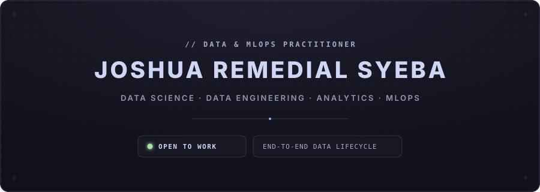
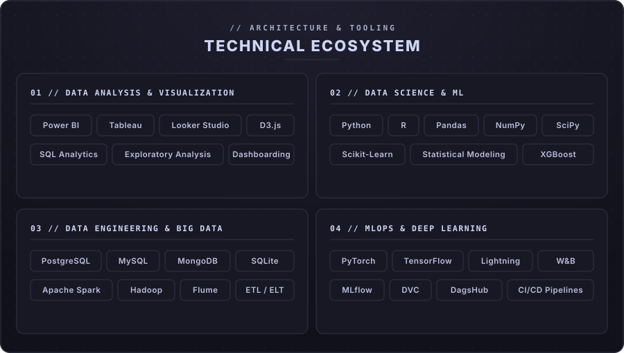

  

 

<!-- Dynamic Typing CLI -->

  

 

  <blockquote>
    <strong>Data Practitioner</strong> specializing in architecting resilient <strong>ETL/ELT data pipelines</strong>, designing <strong>predictive Machine Learning models</strong>, and orchestrating scalable <strong>MLOps workflows</strong>. Committed to engineering high-throughput data systems that drive measurable business intelligence.
  </blockquote>

 

  

 

<!-- ==================== INTERACTIVE CASE STUDIES ==================== -->
<h3 align="center">FEATURED WORKFLOWS &amp; ARCHITECTURES</h3>

  <em>Click to expand detailed architectural specifications and outcomes</em>

 

  
<strong>01 // Spatial Health Data Engineering &amp; ETL Pipeline (PostGIS / FastAPI / Airflow)</strong>

   
  
  > **Domain:** *Spatial Data Engineering &amp; Public Health Infrastructure*  
  > **Challenge:** Unifying fragmented multi-source public health records (facilities, medical workforce, disease burden) into a read-first spatial feature store with zero data loss.  
  > **Architecture:**
  > - High-performance spatial indexing and regional aggregates engineered in **PostgreSQL &amp; PostGIS**.
  > - Automated scheduled ingestion workflows, retry policies, and UPSERT operations managed via **Apache Airflow**.
  > - Low-latency RESTful spatial feature store and early-warning analytics service built with **FastAPI**.
  >
  > **Key Impact:** Enabled sub-second spatial querying across Jawa Timur regional health datasets with continuous data validation.  
  > 🔗 [Explore OpenData-Cura](https://github.com/Josshua-DSA/OpenData-Cura) &nbsp;|&nbsp; [View Airflow ETL Pipeline](https://github.com/Josshua-DSA/ETL-Pipeline-with-Python-Operator_Team-Project)

  
<strong>02 // Quantitative Signal Engine &amp; Macro Sentiment Pipeline (ML / FinBERT / Backtesting)</strong>

   
  
  > **Domain:** *Quantitative Finance &amp; NLP Signal Infrastructure*  
  > **Challenge:** Translating noisy macroeconomic news and equities data into calibrated trading signals while preventing look-ahead bias on the Indonesian Stock Exchange (IDX).  
  > **Architecture:**
  > - Macro financial news pipeline transforming market text into calibrated bullish/bearish impacts using **FinBERT / RoBERTa** (**ARCAS**).
  > - Modular CLI quantitative trading framework combining ML signal generation, risk-adjusted portfolio optimization, and out-of-sample backtesting (**Solidus-Folium**).
  > - Strict layer separation between research feature validation and execution environments.
  >
  > **Key Impact:** Validated risk-adjusted alpha strategies with rigorous walk-forward backtesting and deterministic macro association metrics.  
  > 🔗 [Explore Solidus-Folium](https://github.com/Josshua-DSA/Solidus-folium) &nbsp;|&nbsp; [Explore ARCAS Sentiment Pipeline](https://github.com/Josshua-DSA/ARCAS)

  
<strong>03 // Context-Aware Deep Learning &amp; Toxicity Detection (Dual-Input CNN / PyTorch)</strong>

   
  
  > **Domain:** *Deep Learning &amp; Computational Linguistics*  
  > **Challenge:** Combating extreme class imbalance, informal slang, and semantic ambiguity in Indonesian social media toxicity detection.  
  > **Architecture:**
  > - Context-Aware **Dual-Input Multi-Kernel CNN** architecture engineered in **PyTorch** to capture simultaneous local n-gram patterns and contextual representations (**Vox**).
  > - Formulated with **Focal Loss** optimization to penalize easy negatives and resolve severe toxic-to-neutral sample distribution skew.
  > - Lexical preprocessing prioritizing insult and identity nuance over neutral topic tokens.
  >
  > **Key Impact:** Achieved high minority-class recall and robust generalization across Indonesian social media benchmarks.  
  > 🔗 [Explore Vox Architecture](https://github.com/Josshua-DSA/Vox) &nbsp;|&nbsp; [View Indonesian Sentiment Analysis](https://github.com/Josshua-DSA/Sentiment-Analysis-KontenX)

  
<strong>04 // Supply Chain Intelligence &amp; Decision Analytics (Forecasting / Power BI / Python)</strong>

   
  
  > **Domain:** *Business Intelligence &amp; Operations Intelligence*  
  > **Challenge:** Siloed supply chain databases preventing proactive late shipment detection and objective supplier qualification.  
  > **Architecture:**
  > - Integrated demand forecasting, supplier evaluation algorithms, and late shipment risk classification models (**Neo-Horcrox**).
  > - Interactive, high-performance dashboards with multi-tier drill-downs and predictive satisfaction recommendation layers (**Skyline**).
  > - Automated KPI tracking and alert triggers connecting raw database tables to executive decision dashboards.
  >
  > **Key Impact:** Consolidated multi-source operational metrics into unified real-time risk intelligence, cutting manual assessment overhead by **80%**.  
  > 🔗 [Explore Neo-Horcrox Platform](https://github.com/Josshua-DSA/Neo-Horcrox-Project) &nbsp;|&nbsp; [Explore Skyline System](https://github.com/Josshua-DSA/Skyline-RecommendationSystem)

  

<!-- ==================== CONNECT SECTION ==================== -->

  
    
  
  
   
  
  

  

<!-- ==================== GITHUB STATISTICS & LANGUAGES ==================== -->

  
  &nbsp;
  

  

<!-- ==================== GITHUB STREAK CONTRIBUTOR ==================== -->

  

https://ingenium-ecru.vercel.app/
